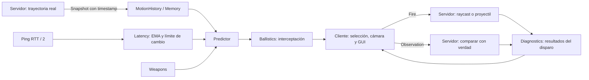

# Aim Lab · Roblox Studio

Prototipo modular de asistencia de apuntado para una **experiencia propia**. Incluye objetivos móviles, modo Memory, auto prediction, perfiles hitscan/proyectil, interfaz nativa oscura y mediciones autoritativas del servidor. No integra ni modifica Da Hood: sus mecanismos internos y la escala `13.371600151062012` son desconocidos.

## Versión autónoma: DH PREDICTION LAB

[`DaHoodPrediction.lua`](DaHoodPrediction.lua) incorpora los módulos existentes en **un solo archivo Luau de cliente**, con menú azul, perfiles Revolver/Default/Custom, calibración y configuración JSON. Abre `build/DHPredictionLab.rbxlx` en Studio y pulsa Play, o copia el archivo a StarterPlayerScripts de tu experiencia. El arranque automático observa personajes con ping del cliente y audita APIs antes de crear el menú; el simulador sigue disponible. El proyecto modular original permanece disponible.

[Instalación y controles](docs/STANDALONE.md) · [GitHub y loader](docs/DISTRIBUTION.md) · [Compatibilidad y límites para Da Hood](docs/DA_HOOD_COMPATIBILITY.md) · [Pruebas](docs/VALIDATION.md)

## SEDWARE / PINK DOT LOCK — proyecto independiente

[`PinkDotLock.lua`](PinkDotLock.lua): C selecciona un personaje con mira central en primera persona o cursor en tercera persona y C lo libera. DOT Hot Pink de 6 píxeles, cámara libre, avisos compactos y configuración al principio del archivo; sin menú. Reutiliza Memory, latencia y balística, añade predicción X/Z e Y por separado y conserva DH PREDICTION LAB. No integra el sistema de disparo de Da Hood.

[Configuración, API, demo de disparo propio y pruebas](docs/PINK_DOT_LOCK.md). `python3 scripts/build_pink.py` genera el archivo y los lugares de Studio; `python3 scripts/check_pink.py` ejecuta sus comprobaciones.

[Auditoría y arma propia integrada](docs/SEDWARE_WEAPON_INTEGRATION.md): la demostración de Studio incluye un Tool **SEDWARE Revolver**. C bloquea; clic consume la posición predicha, o la mira cuando no existe bloqueo. Su servidor valida y confirma raycast/daño reales. Este Tool es propio y no modifica el Revolver original de Da Hood. Abre [PinkDotLockTest](studio/PinkDotLockTest.rbxlx) con servidor y dos jugadores; ejecución nativa pendiente.

[Corrección de inicialización y guía de consola SEDWARE](docs/SEDWARE_INITIALIZATION.md): espera limitada de recursos, diagnósticos por fase y de C; valores X/Y conservados.

[Corrección de LockKey en v3](docs/SEDWARE_LOCKKEY.md): acepta `"C"` y Enum.KeyCode.C mediante normalización nativa estricta. 306 pruebas pasan, incluida la integración del arma propia; no se verifica Da Hood mediante dobles.

[SEDWARE.lua](SEDWARE.lua) ofrece una entrada estable que carga PinkDotLock.lua de main; recibe futuras correcciones usando la misma URL.

[Raw SEDWARE nuevo verificado](https://raw.githubusercontent.com/sedonkkk/sedon-/ed141a9b2f0dcf8e4c9a677aa6c5a4fb0edcc28e/PinkDotLock.lua) · [PinkLoader.lua](PinkLoader.lua) · [Demo listo para Studio](studio/PinkDotLockTest.rbxlx). 210 pruebas de Pink/SEDWARE y 96 anteriores pasan; motor de Studio y Da Hood sin comprobar.

## Ejecutar

Abre [`build/AimLab.rbxlx`](build/AimLab.rbxlx) con Roblox Studio y pulsa **Play**. Selecciona un bot con el cursor, mantén **RMB** para orientar la cámara y dispara con **F** o el botón. Puedes minimizar y mover el panel. Sus seis secciones incluyen los controles de predicción, blancos, armas y diagnósticos.

Para regenerar el archivo después de editar código:

```sh
python3 scripts/build_place.py
```

[Instalación, estructura de Explorer y pruebas en Studio](docs/STUDIO.md) · [APIs verificadas y límites](docs/API.md) · [Calibración](docs/CALIBRATION.md) · [Validación](docs/VALIDATION.md)

## Arquitectura



| Archivo | Responsabilidad |
| --- | --- |
| `src/shared/Settings.luau` | Valores por defecto, unidades, validación y calibración por arma. |
| `Latency.luau` | Ping normalizado, EMA temporal, interpolación de sesgo y límite de variación. |
| `MotionHistory.luau` | Historial acotado, rechazo de datos inválidos, velocidad/aceleración, reinicios. |
| `Predictor.luau` | Edad de la muestra + latencia física estimada + tiempo de vuelo. |
| `Ballistics.luau` | Interceptación y compensación opcional de caída; detecta soluciones inalcanzables. |
| `Geometry.luau` | Geometría finita de segmentos y colisiones relativas. |
| `Weapons.luau` | Perfiles **de laboratorio**, independientes de otros juegos. |
| `Diagnostics.luau` | Registros acotados, RMSE y tasa de impactos al blanco elegido, por arma. |
| `src/server/Main.server.luau` | Escenario, verdad analítica, snapshots, validación de disparos y telemetría. |
| `src/client/Main.client.luau` | Selección retenida en FOV, disparos, mediciones, cámara y ciclo de vida. |
| `src/client/Interface.luau` | UI nativa, seis pestañas, controles y visualización de métricas. |
| `tests/` | Pruebas Luau sin dependencias de Roblox, con adaptador vectorial. |

## Modelo temporal

Para una muestra tomada en `tₛ`, usada en `tₙ`:

```text
edad = max(0, tₙ - tₛ)
delay = clamp(EMA(RTT/2) + sesgo_calibrado + offset_global + offset_arma, min, max)
horizonte_inicial = edad + delay
ventana = min(horizonte_inicial, ventana_confiable)
posición_base = posición_muestra + velocidad × horizonte_inicial
                 + aceleración × (ventana × horizonte_inicial − ½ × ventana²)
```

El modo manual sustituye `EMA(RTT/2) + sesgo_calibrado` por segundos elegidos por el usuario. El delay se suaviza también con un límite de cambio por segundo. La edad de la muestra **no se añade al ping ni se suaviza**: describe un retraso ya ocurrido.

Hitscan no añade tiempo de vuelo ni multiplica la predicción por distancia. En proyectiles se resuelve el tiempo de intercepción con velocidad relativa; si existe gravedad, se compensa la caída y se verifica el residuo de la solución. No se extrapola aceleración desconocida durante todo el vuelo: se usa una velocidad estimada al lanzamiento. Apagar Distance Prediction conserva el tiempo de vuelo del proyectil pero deja de anticipar el movimiento durante él, útil como comparación experimental.

Corta (`<40 studs`), media (`40–120`) y larga (`≥120`) son categorías de diagnóstico, no ganancias de predicción. Los límites son convenciones ajustables del laboratorio. El historial se reinicia en cambios de estado, reversas o discontinuidades y rechaza timestamps desordenados, valores no finitos y velocidades fuera de límites.

## Rendimiento y mantenimiento

El servidor publica a 20 Hz; el cliente estima/selecciona a 30 Hz por defecto, mide predicción a 5 Hz y actualiza texto a 10 Hz. Por frame solo dibuja y orienta la cámara. Los historiales, métricas, colas de observación y proyectiles tienen límites. Se desconectan eventos al destruir los scripts/GUI y se limpian datos al retirar jugadores. Todos los remotes pertenecen a este proyecto; el servidor valida origen, tipos, cooldown, blanco y límites de recursos, y calcula los impactos.

Los ajustes de la UI duran la sesión. Para conservar defaults cambia `Settings.luau`; las características de disparo autoritativas se editan en `Weapons.luau`, no en remotes de juegos ajenos.

## Descargar desde GitHub

[DaHoodPrediction.lua](https://github.com/sedonkkk/sedon-/blob/main/DaHoodPrediction.lua) · [Raw verificado](https://raw.githubusercontent.com/sedonkkk/sedon-/47a278a38ae3b7ce48fa2184bcf7ff0bd12bcedf/DaHoodPrediction.lua) · [Loader.lua](Loader.lua)
