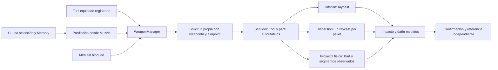

# SEDWARE v4: armas propias con una selección compartida

**No existe integración con las armas originales de Da Hood.** El loader autónomo sigue siendo selección, DOT y predicción de cliente. La arquitectura nueva se instala en una experiencia propia con sus controladores y componentes de servidor; no convierte cualquier arma ajena en compatible.

## Diagnóstico exacto

`Session:_step()` calcula `Prediction:predictComparisons()`; `GetPredictedPosition()` devuelve la posición active. El DOT consume la posición **observada** de la parte y es independiente del destino del disparo. Ninguna función de ese archivo reemplaza el controlador de armas de Da Hood.

`CreateShotAdapter()` captura una instantánea y compara una referencia independiente. Su método `fire()` únicamente ejecuta el callback autorizado suministrado por el integrador; sin callback devuelve `no-fire-callback`. No busca armas ni conecta remotes de otros juegos. La demo anterior conectaba solamente el Tool propio SEDWARE Revolver.

El código interno, contrato de disparo y validación del servidor de Da Hood no están disponibles como una API autorizada documentada para esta integración. Para cambiar sus armas hace falta la colaboración del propietario y el código de su experiencia. No se han implementado hooks, evasión, inyección, ni modificación de comunicaciones protegidas.

## Arquitectura y archivos

| Archivo | Función |
| --- | --- |
| [WeaponManager.luau](../src/pink_weapon/WeaponManager.luau) | Registra perfiles/controladores, observa Equipped/Unequipped/Activated/Deactivated y cambios de jerarquía de Tools registrados. Mantiene **una** sesión de selección, Memory, adaptador y secuencia de IDs. Gestiona la cadencia y el disparo automático sostenido. |
| [WeaponProfiles.luau](../src/pink_weapon/WeaponProfiles.luau) | Definiciones configurables y validadas, compartidas por cliente y servidor. No contiene propiedades supuestas de Da Hood. |
| [ClientController.luau](../src/pink_weapon/ClientController.luau) | Locked recibe el punto público predicho; Normal recibe la mira. Correlaciona ID, sesión y arma, y espera el resultado final. Un lanzamiento de proyectil no confirma impacto. |
| [ServerController.luau](../src/pink_weapon/ServerController.luau) | Valida identidad del Tool equipado, perfil, origen, vida, timestamps, distancias y cooldown. El servidor elige daño, física y dispersión. |
| [Spread.luau](../src/pink_weapon/Spread.luau) | Direcciones dentro de un cono elegidas con aleatoriedad del servidor; consulta cada pellet independientemente. |
| [ProjectileTracker.luau](../src/pink_weapon/ProjectileTracker.luau) | Barre los segmentos de posiciones observadas de un proyectil físico; finaliza por colisión, alcance, duración o error. No decide impactos por proximidad al objetivo predicho. |
| [NativeVerification.luau](../src/pink_weapon/NativeVerification.luau) | Comprobación opcional F6 que equipa los Tools, utiliza Tool:Activate y exige respuestas nativas de impacto y daño. Genera un informe PASS/FAIL. |
| [Probe.client.luau](../src/pink_demo/Probe.client.luau) | Integra inventario, cámara, Manager, notificaciones y comprobación F6 en Studio. |
| [Probe.server.luau](../src/pink_demo/Probe.server.luau) | Entrega seis Tools propios, ejecuta Workspace:Raycast y TakeDamage, crea proyectiles físicos y publica resultados medidos. |



Cambiar de arma no llama a UnlockTarget, no recrea Memory y no busca otro jugador. Se invalida únicamente el suavizado de salida del modelo anterior. La predicción de render y del disparo usan el mismo Muzzle; así no se mezcla una solución de gravedad calculada desde la cabeza con otra desde el arma. La cámara permanece libre.

## Perfiles de la demostración

Son definiciones del laboratorio, no datos del juego original. PredictionX/Y conservan **0.1205 / 0.0800 segundos**; Auto Prediction y Memory siguen disponibles en la configuración original.

| ID | Controlador | Alcance | Cadencia | Daño | Particularidad |
| --- | --- | ---: | ---: | ---: | --- |
| Revolver | Hitscan | 400 | 0,35 s | 25 | Un raycast, sin dispersión. |
| Pistol | Hitscan | 300 | 0,20 s | 15 | Un raycast. |
| Shotgun | Dispersión hitscan | 180 | 0,80 s | 6 por pellet | 8 pellets, cono de 3°. |
| Rifle | Hitscan | 600 | 0,30 s | 30 | Cono de 0,15°. |
| Automatic | Hitscan sostenido | 400 | 0,12 s | 8 | Mantener clic; cono de 1°. Soltar/cambiar arma detiene el bucle. |
| Projectile | Part física | 250 | 0,70 s | 35 | Velocidad 160 studs/s; gravedad 196,2 studs/s²; vida máxima 3 s. |

En hitscan no hay tiempo de vuelo. La dispersión conserva el punto predicho como eje del cono y puede fallar legítimamente. El proyectil es una Part no anclada con AssemblyLinearVelocity y propiedad de red del servidor (`SetNetworkOwner(nil)`); una VectorForce compensa la diferencia entre la gravedad de Workspace y la del perfil. Sus posiciones proceden de la física de Roblox. Un raycast entre posiciones consecutivas detecta el contacto en la escena.

La colisión del proyectil barre su línea central; no incluye el volumen de la esfera, penetración ni rebotes. Un perfil de proyectil con varios pellets requiere ampliar ese controlador: se rechaza explícitamente en esta versión. Un modelo físicamente inalcanzable o una predicción ausente impide enviar el tiro bloqueado y muestra el error.

## Registrar otras armas autorizadas

Añade el perfil al módulo compartido `WeaponProfiles.defaults()` antes de inicializar el servidor y el cliente. El servidor también debe crear o registrar la **identidad exacta** del Tool correspondiente. Los atributos/nombres por sí solos no autorizan un objeto copiado.

```lua
ownedProfiles.Carbine = WeaponProfiles.normalize("Carbine", {
    Name = "Mi carabina", Family = "Custom", Kind = "Hitscan",
    Range = 500, Cooldown = 0.18, Damage = 21,
    Automatic = true, SpreadDegrees = 0.6,
    PredictionXOffset = 0.005, PredictionYOffset = 0,
})
-- Usa ownedProfiles en ambos constructores y registra su Tool en el servidor.
```

La inscripción posterior del cliente no modifica las reglas del servidor. Un ID desconocido o distinto del Tool equipado es rechazado. No se aceptan daño, velocidad, dispersión ni propiedades del arma desde la solicitud de disparo.

Para un controlador propio diferente, registra su callback en el Manager del cliente y su implementación/validación correspondiente en el servidor:

```lua
manager:registerController("Carbine", function(request, context)
    -- context.aimpoint: predicción si Locked, mira si Normal.
    -- request conserva IDs, origen, modo y referencia del objetivo.
    -- Este callback pertenece a TU controlador autorizado.
    ownedFireRemote:FireServer(request)
end)
```

El Manager solo observa los Tools que se registran mediante `manager:track(tool, "Carbine")`. No intercepta controles de armas desconocidas. El adaptador base del ejemplo puede reutilizarse para otros controladores que cumplan ese contrato; no garantiza compatibilidad con implementaciones arbitrarias.

## Comprobar disparos nativos en Studio

Abre [`studio/PinkDotLockTest.rbxlx`](../studio/PinkDotLockTest.rbxlx). Contiene once fuentes exactas: el payload autónomo, ocho módulos del sistema de armas y los dos scripts de integración. Alternativamente sincroniza [sedware.project.json](../sedware.project.json) mediante Rojo en tu experiencia propia.

1. Inicia **Start Server con 2 Players**. Colócalos a unos **15–25 studs**, sin obstáculos para la prueba inicial. El segundo jugador debe quedarse quieto. El servidor entrega los seis Tools a la mochila.
2. En el primer cliente pulsa **C** para seleccionar al segundo. Comprueba el DOT rosado. Mueve el cursor hacia otro lugar visible, por ejemplo el suelo; mantiene al objetivo dentro de pantalla. Así la mira normal y el punto bloqueado serán distintos.
3. Equipa cada arma y dispara con clic; con Automatic mantén y suelta. Al cambiar comprueba el mismo objetivo y DOT. Para Projectile espera **IN FLIGHT** y después el resultado final; no se confirma nada al crear la Part.
4. Para la secuencia automática nativa pulsa **F6**, después de C. No dispares manualmente durante esa secuencia. Equipa todos los Tools, dispara mediante sus eventos, comprueba que el bloqueo y DOT continúan, exige contactos/daño y finalmente desbloquea para comprobar el modo Normal. No inyecta la tecla C: debe haber observado tu pulsación real.
5. Consulta `[SEDWARE][NATIVE RUN][PASS/FAIL]` en Output del cliente. El JSON también queda en el atributo local `Players.LocalPlayer.SEDWARE_NativeReport`. El servidor registra cada respuesta en `[SEDWARE Weapon][RESULT]` con arma, modo, pellets, impacto, daño, física y tiempo de referencia. Guarda ese JSON y Output como evidencia de la ejecución nativa.
6. Fuera del F6, prueba movimiento, salto, cámara libre, primera/tercera persona, obstáculos, desbloqueo con C y respawn. Un obstáculo debe impedir daño al objetivo; un ForceField puede producir contacto con daño cero. Son resultados legítimos que no se ocultan.

F6 eleva temporalmente la vida del objetivo a 10.000 para probar todas las armas sin matarlo, y el servidor restaura su vida y máximo anteriores al finalizar, abandonar o vencer el plazo. Esto es preparación del escenario. Cada decremento de vida proviene de TakeDamage después de una colisión medida; no se fabrican impactos. Un ForceField, movimiento, ausencia de respuestas o una calibración que falle produce FAIL en la comprobación de daño. PASS requiere contacto y daño positivo en cada perfil, repetición automática, modo Normal final y una mira distinta del punto bloqueado.

Detener únicamente el script servidor destruye sus remotes/Tools/proyectiles y limpia el cliente. Reinicia Play con servidor y clientes para conectar nuevamente toda la demostración.

## Integraciones verificadas y pendientes

| Integración | Código compilado | Prueba del puente con dobles | Disparos nativos |
| --- | --- | --- | --- |
| Revolver y Pistol propios | Sí | Sí | **Pendiente** |
| Shotgun propia, 8 pellets | Sí | Sí | **Pendiente** |
| Rifle propio | Sí | Sí | **Pendiente** |
| Automatic propia, mantener/soltar | Sí | Sí | **Pendiente** |
| Part física propia y confirmación diferida | Sí | Sí | **Pendiente** |
| Perfil/controlador propio adicional | Contrato y registro | Sí, perfil Custom de prueba | **Pendiente** |
| Armas originales de Da Hood | **Sin integración** | No | **No compatibles con este puente** |

Esta máquina Linux no dispone del motor de Roblox Studio. **No se ejecutaron aquí disparos reales en Roblox ni en Da Hood.** La implementación y el comprobador nativo están entregados; la validación con el motor sigue pendiente. Aprobar las pruebas de código no completa esa validación ni implica que se haya solucionado el disparo de Da Hood.

```sh
python3 scripts/build_pink.py
python3 scripts/check_pink.py
python3 scripts/check.py
```

Luau oficial 0.695: 33 fuentes Pink/SEDWARE compiladas. **246 pruebas de Pink/SEDWARE, 4.633 comprobaciones; 96 anteriores, 75.895 comprobaciones. Total: 342 pruebas, 80.528 comprobaciones, cero fallos.** Las 36 nuevas cubren perfiles, dispersión, segmentos físicos, los seis Tools con el bundle real, cambio de arma, cadencia, respuestas diferidas, spoofing de perfiles, recursos, limpieza y rechazo de un informe simulado como evidencia nativa. Los eventos, posiciones físicas y raycasts de esas pruebas son dobles explícitos.
